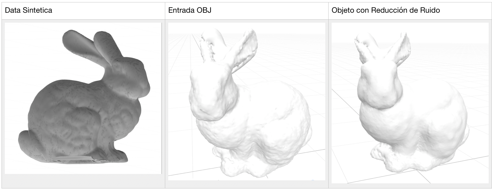

# Programaci-nDeVideoJuegos: Whac-a-Mole with denoised point-cloud meshes

A video game programming course submission (Programación de Videojuegos, December 2019).
It is a **copy of [InteraccionHumanoComputador](https://github.com/Wil12Fred/InteraccionHumanoComputador)**,
the Leap Motion *Whac-a-Mole* game in OpenGL/GLUT, with one change: the mole model
is replaced by a mesh rebuilt from a point cloud, before and after noise reduction.

| | |
|---|---|
| input | `input_mesh.obj` (noisy reconstruction, 87,640 vertices) |
| output | `point_cloud_denoised.obj` (149,106 vertices) |
| also | `original_mesh.obj`, `poisson_mesh*.ply` (PCL Poisson reconstructions), `bunny.obj/.ply` (Stanford bunny) |



The meshes were produced with PCL and MeshLab (per their file headers). **The
denoising code itself is not in this repository**, only its inputs and outputs. In
`client.cc` the mole model is `point_cloud_denoised.obj`, or `original_mesh.obj`
when the `topoo` flag is off. These replace `Topo.obj` and `Diglett.obj`. That is the only code difference from
InteraccionHumanoComputador, along with the server address (`0.0.0.0` here).

## Build and run

Same as InteraccionHumanoComputador:

```sh
sudo apt install freeglut3-dev libpng-dev
make                                   # server, lighting demo, compile-check of the clients
make client LEAP_SDK=$HOME/LeapSDK     # needs the Leap Motion SDK v2.3.1 (not verified)
./server                               # Port 1200: connection success
```

The game client needs a Leap Motion controller and its proprietary SDK v2.3.1, which are
not available here, so **the client link is BUILD NOT VERIFIED**. The server and
`iluminandoTortuga/` build and run on Linux.

## Why the repository is 72 MB

| File | Size |
|---|---|
| `IHCFinal.mp4`, demo video (same as in InteraccionHumanoComputador) | 51 MB |
| `point_cloud_denoised.obj` | 22 MB |
| `original_mesh.obj` | 13 MB |
| `input_mesh.obj` | 12 MB |
| `poisson_mesh-2.ply`, `poisson_mesh.ply` | 10 MB + 6 MB |
| `11538_Hand_v2.obj`, `bunny.obj`, `bunny.ply` | 6 + 6 + 3 MB |

These are uncompressed text meshes, which git compresses to about 71 MB in total. The
history was not rewritten.
