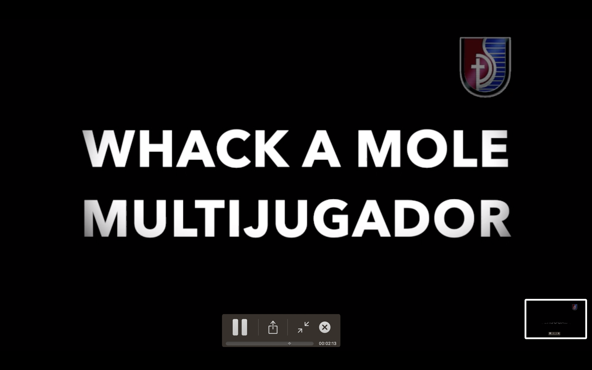

# leap-motion-whac-a-mole

[](https://github.com/Wil12Fred/leap-motion-whac-a-mole/actions/workflows/ci.yml) [](LICENSE)

A 3D *Whac-a-Mole* played with your bare hands: OpenGL/GLUT renders the board and a
Diglett mole ("topo"), a **Leap Motion** controller tracks your hands, and a small TCP
server lets two players share one game — one raising moles, the other knocking them down.

[](https://youtu.be/I3TlLthCp1Q)

*Click for the demo video (also in the repository as `IHCFinal.mp4`).*

## Features

- Hand tracking with the Leap Motion SDK v2: hit a mole by moving your hand onto it.
- 3D scene with OBJ models (mole, hole, hand, trophy), PNG textures, sun and star map.
- Two-player mode over TCP: the first player to join is the *collaborator* (raises
  moles), the second the *killer* (hits them); the server blocks random moles while
  they play and decides who won when all nine are blocked.
- `iluminandoTortuga/`: a separate lighting exercise — a turtle lit by ambient, diffuse
  and specular light with a movable light source.
- `main2.cc`: an earlier single-player version of the game.

Tips from the original notes: keep your hand 15–30 cm in front of the screen, in natural
light.

## Requirements

| | Debian / Ubuntu | Arch Linux |
|---|---|---|
| compiler, make | `g++ make` | `gcc make` |
| OpenGL / GLUT | `freeglut3-dev` | `freeglut` |
| libpng (client textures) | `libpng-dev` | `libpng` |
| tests | `python3 xvfb` | `python xorg-server-xvfb` |
| client only | **Leap Motion SDK v2.3.1** (`libLeap.so`) — proprietary, discontinued, not in this repository | same |

## Build

| Target | Needs | Status on Linux |
|---|---|---|
| `make server` | C++11, pthreads | builds and runs (tested in CI) |
| `make tortuga`, `make smooth` | freeglut | build and run (tested in CI under xvfb) |
| `make check-client` | freeglut headers | `client.cc` and `main2.cc` compile (CI) |
| `make client LEAP_SDK=...` | Leap Motion SDK v2.3.1, freeglut, libpng | **BUILD NOT VERIFIED**: the SDK is proprietary and cannot be installed in CI |

```sh
make                                   # server, tortuga, smooth, compile-check of the clients
make client LEAP_SDK=$HOME/LeapSDK     # only with the Leap SDK installed
```

On macOS the Makefile links the GLUT/OpenGL frameworks. The original macOS steps,
including the `install_name_tool` fix for `libLeap.dylib`, are in `compile.sh`.

## Run

```sh
./server
```

```
Port 1200: connection success
```

It tries ports 1200, 1201, … until one binds, then prints `ConnectFD: <fd>` for every
client that connects.

```sh
./client        # asks for the port, then connects to the server
```

**The client connects to the hard-coded address `172.20.10.2`** (`client.cc`, `main`),
which was the server's address on the LAN used for the demo. To run it elsewhere, change
that address.

```sh
cd iluminandoTortuga && ./iluminandoTortuga    # the lighting exercise
```

## Tests

```sh
make test
```

- `tests/test_utils.cpp` — `fillZeros` padding; the Base64 encoder/decoder in
  `utilidad.h` against the RFC 4648 vectors (`""`, `f`, `fo`, … `foobar`) and a
  file → Base64 → file round trip for every length from 0 to 39 with high-bit bytes; the
  OBJ loader on `tests/data/cube.obj` (one mesh, six quads → 36 indices, coordinates and
  indices in range).
- `tests/test_server.py` — starts the real `./server` and plays the protocol with two TCP
  clients: welcome message, joining as collaborator then killer, the mole count and the
  board, raising mole 3 reaches the killer and shows on the board, and leaving notifies
  the other player. The server's random "mole blocked" pushes are parsed and skipped.
- The two GLUT demos are started on a private `xvfb-run` display and must still be
  running after 4 s.

The client itself is not tested: it cannot be linked without the Leap SDK.

## Project layout

| Path | Contents |
|---|---|
| `client.cc` | game client: GLUT scene, menu, game loop, Leap input, server connection |
| `server.cpp`, `utilidad.h` | two-player TCP server; padding and Base64 helpers |
| `Leap/` | Leap Motion SDK headers and the hand-tracking listener |
| `Model/` | OBJ/material/mesh loading (`ParseObj/obj.h`) |
| `primitivas.h`, `light.h`, `camara.h`, `Vector_tools.h`, `png_texture.h` | drawing helpers, lights, camera, texture loading |
| `*.obj`, `*.mtl`, `*.png`, `*.jpg` | models and textures |
| `iluminandoTortuga/` | the lighting exercise |
| `tests/` | unit tests, server protocol test, a small OBJ |

## Known limitations

- The client needs the proprietary Leap Motion SDK v2.3.1, which is discontinued; its
  build and run are not verified anywhere.
- The client's server address is hard-coded (`172.20.10.2`).
- The server keeps one global game, uses detached threads and no `SO_REUSEADDR`, so a
  restarted server moves to the next port while the old one is in `TIME_WAIT`.
- The repository is about 57 MB because of binaries in history: the demo video
  `IHCFinal.mp4` (51 MB), a model deleted later but still in history
  (`AWARD_ODUL_OBJ.obj`, 11 MB) and `11538_Hand_v2.obj` (6 MB). History was not
  rewritten; the video would fit better as a release asset or with Git LFS.
- Fixed in this pass (with tests): the Base64 encoder padded with the *first* bytes of the
  file instead of the last ones, and the decoder emitted an extra byte for `==` padding.

## Variant: denoised point-cloud meshes

Branch [`variant/denoised-meshes`](../../tree/variant/denoised-meshes) is the same game
with the mole model swapped for point-cloud meshes built with PCL and MeshLab, before and
after denoising (a later video-game programming course, Dec 2019).

## Background

Final project for a human–computer interaction course at university, 2018.

## License

MIT — see [LICENSE](LICENSE) — for the code written for this project. Not covered:
`Leap/Leap.h` and `Leap/LeapMath.h` are Leap Motion SDK headers under Leap Motion's own
SDK agreement; `Model/ParseObj/obj.h` appears to be derived from the public OBJ-Loader
library; the 3D models and textures come from their respective authors.
